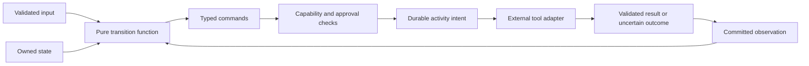

# Agent programming architecture

Status: design proposal. The runtime, durable execution and capability guarantees described here remain unimplemented.

## Library model

APL agent applications use ordinary functions, algebraic data types, typed messages, explicit capabilities, and structured tasks. An agent is a state machine owned by one task or actor. Its state has one mutation owner. Other tasks send messages or receive immutable snapshots. No model API, planner, or `agent` keyword is part of the language core.

The intended library layers are `agent.protocol` for message types and transitions, `agent.tool` for capability-bound tool requests, `agent.workflow` for durable decisions, `agent.trace` for observations, and `agent.test` for deterministic environments. These are ownership boundaries for future implementation, not claims that packages already exist.

A protocol defines `State`, `Message`, and `Command` algebraic data types. Its transition is conceptually `step(State, Message) -> (State, List<Command>)`. This is explanatory notation, not committed APL syntax. In a durable workflow, each recorded message identifies its schema and workflow version. Concurrent completions become ordered events before the deterministic transition observes them.

## Authority is a value and a runtime restriction

A typed tool has request, response, and explicit error types. Invocation requires an opaque capability whose constructor belongs to a trusted authority provider. Ordinary code cannot manufacture the capability from a string or deserialize it from model output. Restriction must be enforced by the adapter, so `ReadFile<Directory>` validates the resolved file target against the granted directory and handles symlinks according to its documented policy.

Capabilities are attenuable. A parent may grant fewer operations, narrower resources, an earlier expiry, or a smaller budget. Delegation cannot widen authority. A shared reference permits invocation only if the capability's API and runtime policy permit it; linear or affine ownership alone is not an authorization policy.

Effects describe which kinds of interaction a function can perform. Capabilities identify the particular authority available at runtime. Both are needed. `io` does not mean permission to read every file. A safe entry point receives its initial authority explicitly. FFI, unsafe memory, ambient operating-system access, and compromised adapters remain outside the language-level guarantee and inside the stated trust boundary.

The [Cap'n Proto RPC model](https://capnproto.org/rpc.html) demonstrates explicit authority-bearing references. APL uses that design principle without adopting its complete protocol or treating distributed handles as ordinary forgeable integer IDs.

## Approval state machine

Sensitive commands use a protocol with transitions `Proposed -> Approved -> Executing -> Completed` and explicit `Denied`, `Expired`, `Failed`, and `OutcomeUnknown` outcomes. Approval binds the normalized request digest, principal, capability identity, policy version, expiry, and unique operation ID. Changing the request after approval invalidates it.

An approval token is opaque and single-use when the policy requires that. The runtime performs the permission and expiry checks immediately before scheduling the external action. A concurrent revoke/execute race is resolved by a documented authority service or transactional policy check; a stale in-process boolean is insufficient.

The first verification example proves that a transition to `Executing` requires an approval for the same request. This proves a property of the checked transition model. It does not prove that a human understood the action, that the UI displayed the same bytes, or that the external service honors the request. Integration tests and runtime checks cover those additional boundaries.

## Durable execution and recovery

Workflow state changes and outgoing activity intents commit atomically in the selected durable store. An activity ID is stable across retries. A worker records the returned result before delivering it to the workflow. Replay consumes recorded observations and emits commands whose identities and request digests must match history. A mismatch is a diagnostic, never an implicit new external call.

Network effects cannot be made exactly-once solely by a local journal. If a remote action succeeds and the worker crashes before recording success, the outcome is unknown. A retry is permitted only with a remote idempotency key, a reconciliation procedure, or an explicit user policy accepting duplicate risk. Non-idempotent actions remain in `OutcomeUnknown` until reconciled.

Use a transactional local store for the first durable implementation, then evaluate a distributed service when multi-host ownership is required. The storage format includes checksums and versioned schemas. Leases and fencing prevent two workers from concurrently owning the same workflow where the storage service supports that guarantee. Crash tests cover every durable-write boundary before claiming recovery.

The [Temporal replay model](https://docs.temporal.io/workflow-execution) is a reference for comparing workflow commands against stored event history. APL's implementation must establish its own durability, compatibility and external-effect guarantees.

## Determinism and resource limits

Clock readings, randomness, model responses, network results, and scheduler-observed event order enter the workflow only as recorded observations. Deterministic replay fixes the code version, schema versions, initial state and observation history. Floating-point and iteration-order differences need a cross-platform policy before claiming replay across machines.

Live replay does not call a model again and hope for the same answer. A model response remains untrusted data even when stored in a valid history. Tool adapters validate request and response schemas and enforce limits before allocating unbounded memory.

Budgets cover concrete measurable resources, including tool calls, elapsed deadline, recorded bytes, task count, and metered model-token consumption where the provider exposes it. An atomic reservation precedes the action; reconciliation refunds or charges actual usage according to policy. External billing and unreported usage are assumptions. CPU and memory limits require operating-system enforcement or a metered execution environment; a library counter cannot constrain arbitrary native code.

Cancellation is cooperative until an external adapter offers a stronger contract. A canceled workflow stops scheduling new work and requests cancellation of outstanding tasks. It still records outcomes and releases owned resources. A timeout does not imply the remote effect did not happen.

## Protocol and concurrency guarantees

Typed channels reject mismatched messages before execution. Runtime decoding validates messages at process and network boundaries. Version negotiation does not bypass schema validation. Actor state is isolated by ownership; safe shared values must satisfy the language's transfer/share rules.

Structured child tasks belong to a parent scope. Leaving the scope cancels or joins children according to the runtime contract. Durable child workflows have explicit persisted identities and cancellation policies. Channels use backpressure and bounded buffering by default. Data-race freedom, protocol fidelity, deadlock freedom and liveness are separate claims with separate evidence.

Session types are a future optional encoding where ordinary state-machine APIs are insufficient. The initial agent verification program focuses on authorization transitions, budget monotonicity and invariant preservation. It does not promise arbitrary distributed liveness or correct model decisions.

## Observability and test interfaces

Traces connect workflow, task, activity, tool, approval and retry identities. Each event records outcome and duration with a schema version. Sensitive payloads can be omitted, redacted or encrypted by policy. Trace publication is an explicit capability. Replaying a redacted history may require a retained encrypted payload or deterministic fixture, and the tool must explain when replay evidence is incomplete.

A deterministic test environment supplies recorded model/tool responses, virtual time, injected crashes, cancellation, duplicate deliveries and reordering. Tests assert visible workflow state, scheduled effects, and durable records. Adversarial tests try forged capabilities, request substitution after approval, expired grants, budget races, replay divergence, and retry after ambiguous success.

The Phase 5 acceptance program requires a typed multi-agent application, a real durable workflow restarted after process termination, a protected tool gated by approval, and mechanized state-machine invariants tied to the implemented transition function. Passing a toy isolated protocol proof is insufficient for the integrated application claim.

## Dependencies and open decisions

Agent implementation depends on records, tagged unions, generics, modules, explicit errors, ownership, effects, channels, tasks, serialization, time and I/O. Cancellation and authority interfaces must agree with the runtime and formal semantics. Trace inspection and replay are exposed through the development tools.

Open decisions are the first durable-store package, capability revocation across processes, workflow upgrade policy, and trace schema migration. Each requires an executable design comparison in Phase 5. No external service subscription is required by this architecture.
