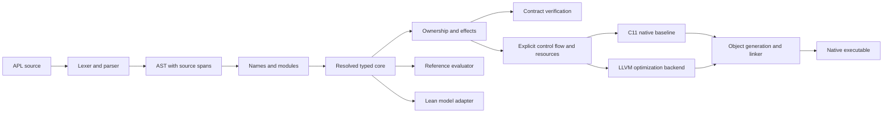

# Compiler architecture and integration contracts

Status: the Rust frontend, typed interpreter, file modules, strict core JSON
adapters, validated structured MIR, and C11 native backend are implemented.
Ownership/effects, contract verification, and language-server integration remain
planned. [Getting started](../getting-started.md) documents the working commands;
the [proof inventory](../../formal/PROOFS.md) covers the Lean expression and
recursive-function model, not Rust implementation correctness.

## Pipeline

M1 ends at typed core execution and formal comparison; the current M2 increment adds modules and native lowering. The ownership pass remains an extension point with no borrow claims for the scalar language. Verifier results annotate obligations; ordinary compilation does not silently certify contracts. A strict verified build mode eventually requires a configured set of proved obligations.

The compiler is a Rust library called by the CLI, with language-server integration planned. The implementation toolchain is pinned to Rust 1.99.1. Each pass returns a result or structured diagnostics. No pass parses a preceding pass's displayed text.

## M1 caller contract

The initial program shape is `fn main() -> i64 { let x = 6 * 7; x }`. The parser accepts the [scalar grammar](../../spec/grammar.ebnf) and [module declarations and paths](../../spec/modules.md). The checker accepts `i64`, `bool`, and unit, explicitly typed function parameters/results, immutable lets with optional local annotations, named function calls including recursion, conditional expressions, and the specified scalar operators. Each implemented form has an explicit formal coverage entry.

The CLI provides `apl check FILE` and `apl eval FILE` in M1. `check` resolves and checks every function, including unused functions, and accepts a typed library file without `main`. `eval` checks first, requires exactly one nullary `main` in the root file with result type `i64`, then displays its decimal result followed by a newline. The implemented `build`, `run`, and `emit-c` commands inherit that entry requirement. Internal expression evaluators may return `bool` and unit, but those are not executable entry types. Successful commands exit 0. Invalid source exits 1. Execution traps exit 2. Evaluation resource exhaustion exits 3 and is not reported as a language trap or divergence proof. CLI invocation or infrastructure errors exit 4.

An evaluation budget bounds interpreter work and call depth. The exact budget accounting is an implementation protocol recorded with tests, not language semantics. The implementation must fail with a diagnostic before exhausting the host stack. A native program is not required to reproduce the interpreter's artificial fuel budget.

## Representations and invariants

| Representation | Component and purpose | Required invariant | Validation |
| --- | --- | --- | --- |
| Tokens and AST | Frontend; preserve syntax and source locations | UTF-8 byte spans refer to the source file; tokens cannot reference outside it; malformed input cannot panic | Lexer/parser negative and recovery tests, fuzzing |
| Resolved core | Resolver; replace source names with function/local identities | Each reference is bound; functions have unique identities; parameter names are unique in their scope | Whole-program name validation |
| Typed core | Type checker; semantic input for evaluator and verifier | Every expression has a scalar type; branch types agree; call arguments match; all operators meet operand rules | Independent core checker and rejection fixtures |
| MIR | Compiler; expose sequencing, branches, traps, future moves/borrows/drop | Every use is defined; operands match instruction types; each block has one terminator; checks dominate partial operations; explicit effects preserve source order | Structural validator and evaluator comparison |
| Backend representation | Backend; implement MIR using C11 or LLVM | ABI/layout match target; no unchecked backend UB for safe core; source traps remain observable | Differential native execution and sanitizer tests |

No serialized representation is trusted merely because it declares itself typed. Imports revalidate tags, numeric ranges, binding indices, call signatures and inferred types. Stable IDs are internal compiler identities; source names remain available for diagnostics. Shared interfaces use owned data and IDs rather than cross-pass references whose lifetimes couple unrelated subsystems.

The current Rust boundaries are internal `syntax`, `modules`, `resolve`, and `mir`, plus `types`, `core`, `eval`, `diagnostic`, and `codegen`. Checked Program contents are opaque to external mutation and construction; source compilation and core import establish their invariants. Contract verification remains a future component.

`compile_file(path)` loads the bounded canonical file graph and checks all bodies.
`compile(source)` performs no filesystem reads and rejects file imports. Each file
has a private namespace with explicit public declarations; the [module rules](../../spec/modules.md)
define visibility, cycles, shared dependencies, and resource bounds. Spans identify
a source file and UTF-8 byte offsets. Private source snapshots retain imported-file
diagnostics and protect all source inputs from native output publication.

## Core interchange with formal tools

Use a versioned JSON document headed by `schema: "apl-core-v0"`. Its semantic content is a function table and entry function ID. Each function contains its ID, printable name, ordered parameter types, result type, and body. Module graphs export as one function table with collision-free generated names; visibility and file boundaries are not represented in this scalar interchange. Constructors have explicit tags: integer, boolean, unit, local, let, if, unary, binary, and call. The frozen member names, semantic revision `m1-2026-11-16`, expression fixture format, and fixtures are published in [core-format.md](../../spec/core-format.md). `apl dump-core FILE` exports checked source; `apl eval-core FILE` independently validates and evaluates the artifact.

Integer literals are decimal strings, avoiding host JSON precision loss. Local references use zero-based de Bruijn indices, with index 0 the most recently bound local. At function entry, the final declared parameter is index 0. A let initializer evaluates in the old environment, and its body evaluates with the new binding at index 0. Function IDs index the complete table, permitting forward and recursive calls. Spans and printable names are metadata and do not change semantics. Expression statements lower to discarded lets, with local indices adjusted to preserve binding and evaluation order. Expression-only proof fixtures use a separate expression fixture format; a program artifact's entry is always a function ID.

The Rust exporter and Lean importer are trusted adapters until separately verified. The Lean side independently validates the imported program. A malformed artifact returns `invalid_ir`, not a proved result. The comparison protocol records `value`, `trap`, or `resource_limit`; successful values include their scalar type and canonical representation. Traps include `arithmetic_overflow` or `division_by_zero` and optional source metadata. A negative or exhausted budget is a tool condition.

This protocol does not prove that the parser faithfully represents source code. Source-level conformance fixtures and later refinement proofs cover that separate boundary. A proof about an expression subset must not be advertised as a proof about all imported function programs.

## Evaluation semantics that lowering preserves

Function arguments and non-short-circuit operands evaluate left to right. `&&` and `||` evaluate their second operand only when required. A conditional evaluates one branch. Lets evaluate once. Traps are observable, so constant folding cannot discard a trapping expression merely because its value is unused.

Signed `i64` arithmetic is checked in every build configuration. Overflow in addition, subtraction, multiplication, or unary negation traps. Division and remainder trap on zero and on `MIN / -1` or `MIN % -1`. Division truncates toward zero. No debug/release semantic switch exists. The type checker rejects arithmetic on booleans and mixed scalar equality. No implicit numeric conversion exists in M1.

The C11 backend emits one temporary per ordered subexpression as needed. It never relies on C argument evaluation order. Checked helpers test preconditions before performing signed operations. Builtins can be used only under an explicitly supported compiler contract; the portable helper path has its own tests. A trap calls a defined runtime handler before the invalid operation. Raw user identifiers never become unescaped C source or shell commands.

The planned LLVM backend must preserve the same checks and use overflow intrinsics or equivalent validated lowering. It cannot attach `nsw`, `nuw`, or other strengthening attributes without their preconditions. LLVM's [IR contracts](https://llvm.org/docs/LangRef.html) and [UB model](https://llvm.org/docs/UndefinedBehavior.html) are backend obligations, not APL language semantics.

## Native interface and runtime boundary

The native baseline passed build, execution, trap, and linking checks on macOS
AArch64 and Linux x86-64 at `ab8d495` ([CI run](https://github.com/djsydney04/ANL/actions/runs/44040702654)).
The module increment requires its own platform checks. Builds target the host;
cross-compilation and qualified installation artifacts remain pending.

Initial internal functions have fixed scalar signatures. Unit has no meaningful payload. The native entry wrapper calls the required nullary APL `main() -> i64`, prints its full decimal result followed by a newline, and returns status 0; it must not truncate the result into the operating system exit code. Arithmetic traps report their code on stderr and exit 2. M4 ordinary I/O programs use an explicitly specified entry ABI and do not inherit this evaluation-oriented display wrapper accidentally.

Foreign calls use an explicit C ABI declaration, target layout, and unsafe boundary until a safe wrapper establishes its preconditions. The compiler owns symbol mangling and ABI versioning. Heap resources and async tasks require a runtime ABI added with their language feature, not guessed from a C struct layout.

The linker driver receives structured arguments through a process API. It checks exit status, preserves diagnostics, and publishes an output artifact only after successful compilation and linking. Missing tools produce actionable diagnostics. Output paths cannot overwrite source inputs. M2 development builds may require a system C toolchain; the final end-user distribution must package or install the supported backend without requiring internal proof-development tools.

## Verification and optimization boundaries

Verification consumes typed core plus explicit contracts. It emits a report bound to source and core hashes, tool versions, assumptions, obligation identities, and per-obligation status. Its status vocabulary and trusted components are defined in the formal-methods specification. Unsupported syntax and solver timeouts cannot become successful proofs.

Planned MIR transforms start with validated constant folding and dead-block removal; the current backend performs no APL optimization passes. Each transform has a semantics statement and tests covering values, traps, and termination behavior within the tested scope. Later inlining, specialization, allocation elimination, loop transforms and layout optimization require explicit effect, alias and ownership conditions. A small transformation proof does not certify the backend.

Formal and native evaluators should not share arithmetic implementation code. Shared schemas are allowed; independent semantics are required to expose correlated mistakes. Differential testing compares terminating values and traps, and labels budget-limited cases inconclusive. Random testing supplements adversarial fixtures rather than replacing them.

## Executable milestone gates

M1 requires parser/checker rejection fixtures, ordinary and recursive execution, integer limits, left-to-right trap order, short-circuiting, shadowing and scope, malformed input diagnostics, and interpreter resource limits. Lean checks its declared theorems with no `sorry` or admitted project axioms. Coverage lists distinguish mechanized expression/function properties from tested source and backend correspondence. Documentation examples compile and execute.

Precedence fixtures reject `1 < 2 < 3` and `1 == 2 == false`, which repeat operators at the same non-associative grammar level. The mixed-precedence expression `1 < 2 == true` is accepted as `(1 < 2) == true`.

M2 additionally requires native binaries at optimization levels 0 and 2, matching results and traps against the interpreter and formal executable model where covered, multi-module linking, clean compiler-error handling, and sanitizer runs over emitted C and runtime helpers. Native success is demonstrated by execution of a machine-code binary, not generated text.

The production backend gate requires representative systems and numerical workloads, checked optimizer transformations, source debugging, target-matrix tests, reproducible build records, and measurements of time, memory, binary size and compile latency against pinned C/Rust baselines. No performance target is considered met by an external backend's reputation.
