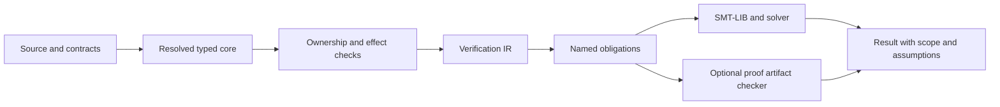

# Formal semantics and verification architecture

Status: Lean 4.36.0 has separate models for immutable scalar functions
(`m1-2026-11-16`) and local scalar state (`local-state-2026-11-17`). The
[proof inventory](../../formal/PROOFS.md) records 118 checked statements: the prior
81 immutable/verification statements and 37 local-state statements. FM-01 through
FM-05 apply to the documented v0 model; local state has its own typing, machine
safety, finite correspondence, and forward v0 embedding results.

The immutable verification generators prove call-free and finite body-expansion
soundness, including ordered arguments and callee preconditions, when generation
succeeds and interpreted obligations hold. FM-07 remains partial: source call-graph
checking, expansion completeness, separate syntax-inlining equivalence, named
condition decomposition, and Rust/SMT/solver bridges remain open. Production
verification stays `smt-trusted` and rejects local state. No theorem here proves
termination, fixed-production-budget completeness, or Rust/JSON/native correctness.

## Two distinct guarantees

The language metatheory concerns typing and execution rules. A theorem about the scalar core establishes only the property stated for that core. Program verification concerns a particular program and contract under explicit assumptions. Neither establishes that an unverified backend emits correct machine code.

Each checked program and its reference semantics, compiler output, verification report, and documentation identify the applicable semantic revision. Each language change identifies affected definitions, theorem statements, obligations, and tests before acceptance.

## Initial immutable semantic domain

The M1 core has types `i64`, `bool`, and `unit`. Integer values belong to `I = {n ∈ ℤ | -2^63 ≤ n ≤ 2^63-1}`. Values are `Int(n)`, `Bool(b)`, or `Unit`. Identifiers resolve to lexical bindings and function identifiers before formal-core exchange. Types remain explicit in function parameter and result declarations.

Terms contain literals, local variables, immutable `let`, unary operators, binary operators, conditionals, and calls to named functions. `let` creates a new lexical binding. Function parameters bind only within the callee body. A complete function signature table is constructed before bodies are checked, so mutual recursion is well defined. No implicit scalar conversion exists. Source blocks elaborate to nested lets and a final expression. An omitted final expression becomes unit. An expression statement becomes a fresh discarded let, preserving evaluation and traps. That elaboration must adjust binding indices, and remains a tested correspondence obligation.

The signature table is `Σ(f) = (τ₁ … τₙ) → τ`. The local context `Γ` maps lexical bindings to types. Representative judgments are:

```text
Γ(x) = τ
────────────────────────────
Σ; Γ ⊢ x : τ

Σ; Γ ⊢ e₁ : τ₁       Σ; Γ,x:τ₁ ⊢ e₂ : τ₂
───────────────────────────────────────────
Σ; Γ ⊢ let x = e₁ in e₂ : τ₂

Σ; Γ ⊢ c : bool       Σ; Γ ⊢ a : τ       Σ; Γ ⊢ b : τ
────────────────────────────────────────────────────
Σ; Γ ⊢ if c then a else b : τ

Σ(f) = (τ₁ … τₙ) → τ       Σ; Γ ⊢ eᵢ : τᵢ for every i
──────────────────────────────────────────────────────
Σ; Γ ⊢ f(e₁ … eₙ) : τ
```

Arithmetic accepts `i64` operands and returns `i64`. Ordered comparison accepts `i64` operands and returns `bool`. Equality accepts two values of the same scalar type and returns `bool`. Boolean negation, conjunction, and disjunction accept only `bool`. A function body must match its declared result. A `let` annotation, when present, must equal the inferred initializer type.

## Evaluation and faults

An expression configuration contains a term, its lexical environment, and the global function definitions. A small-step relation maps configurations to configurations, values, or defined traps. The mathematical relation has no fuel argument. Infinite reduction represents divergence.

Evaluation is left to right. A trap in an evaluated operand propagates before subsequent operands are evaluated. `false && e`, `true || e`, and the unchosen conditional branch do not evaluate `e`. For `let x = a in b`, evaluate `a` first and then `b` in the extended environment. A function call evaluates arguments in source order, checks the arity statically, and evaluates the body with only its parameters and local bindings. Free caller-local variables are inaccessible.

For `+`, `-`, `*`, and unary negation, compute in mathematical integers, then test membership in `I`. An out-of-range result gives `Overflow`. Division and remainder first reject a zero divisor with `DivisionByZero`, then reject operands `(-2^63, -1)` with `Overflow`. Otherwise, division uses truncation toward zero and remainder is `a - trunc(a/b) * b`. Negative literals have a parser rule that accepts `-9223372036854775808` while rejecting positive `9223372036854775808`; the specification must not evaluate an out-of-range positive intermediate to represent the minimum integer.

Type safety means an accepted closed term cannot get stuck because of a type mismatch, unresolved variable, or invalid function application. It does not mean every well-typed term returns. Defined arithmetic traps and divergence are permitted. Trap freedom requires additional verification.

An executable reference evaluator has outcomes:

```text
Value(value)
Trap(kind)
ResourceLimit(reason)
InvalidInput(diagnostic)
```

`ResourceLimit` includes fuel and stack limits and is not an APL value, trap, or proof of divergence. Differential tests compare values and trap kinds; they report resource-limited cases as inconclusive. Invalid serialized inputs fail validation before evaluation.

## Local-state semantic extension

[Local state](../../spec/control-flow.md) adds initialized `let_mut`, assignment,
and while constructors in v1. Its separate machine carries the current value
environment on evaluation and return. Scope exit removes only the newly bound
cell, retaining updates to outer cells. Operand, branch, and argument frames pass
current state onward; calls copy evaluated argument values and restore the caller
state captured after those evaluations. Loop condition/body frames replace one
another across each back edge, including the final false condition's effects.

The declarative context records each scalar type and mutability permission.
Inference is proved equivalent to that judgment. Initialized-environment update
and scope lemmas support preservation/progress for all machine transitions,
recursive entry safety, and exclusion of invalid states. Defined arithmetic traps
and continued execution remain permitted. Finite `run` and the independent `Step`
relation agree in both directions. These are model type-safety guarantees, not
termination, trap-freedom, or production-checker proofs.

Embedding a finite v0 evaluator result preserves its value or trap in a sufficiently
budgeted v1 run. This is a forward result, without reverse termination/divergence
correspondence. The v1 CLI counts machine transitions; Rust counts expression
entries and separately limits nesting to 256. Equal fuel values do not imply equal
work, and any resource-limited comparison is inconclusive. The strict v1 JSON
adapter, source lowering, and native backend remain tested correspondence boundaries.

## Mechanization boundaries and proof obligations

Lean 4 defines untyped core syntax, the typing relation, values, transitions, and an executable evaluator. A separate typing relation prevents a proof from assuming the production type checker has already established the property at issue. The representation may use de Bruijn indices for local variables, with a documented context order and capture-avoiding substitution.

| Obligation | Scope and acceptance evidence |
| --- | --- |
| FM-01 | Scalar expression typing is deterministic. A kernel-checked theorem covers every supported literal, variable, operator, `let`, and conditional constructor. |
| FM-02 | Preservation for the same expression core. A well-typed transition preserves type, or reaches a defined trap; intermediate configurations have an explicit typing judgment. |
| FM-03 | Progress for the same expression core. A closed well-typed configuration is a value, takes a step, or reaches a defined trap. |
| FM-04 | The executable formal evaluator agrees with the relation for successful finite executions. Fuel exhaustion makes no semantic claim. |
| FM-05 | Extend FM-01 through FM-04 to well-typed global function environments, calls, and recursive calls. Prove safety without assuming termination. |
| FM-06 | The implemented checker, resolver, and serializer agree with the formal definitions. Initial evidence is differential and negative testing; a proof of correspondence is a later strengthening. |
| FM-07 | Soundness of the initial pure-fragment verification-condition generator, including trap obligations and checked-integer bounds. |
| FM-08 | Semantic preservation for each selected core simplification or lowering pass. Record theorem or validator scope per pass. |

FM-01 through FM-05 are discharged for the documented scalar expression/function model. A release claim must retain that scope and name exactly which obligations are machine checked. A theorem about an intrinsically typed evaluator alone does not prove that an external untyped program is correctly accepted.

The expression and program models use untyped syntax, separate declarative
typing judgments, proved inference soundness/completeness, typed intermediate
states, and fuel-free small-step relations. The program proofs cover recursive
calls, ordered arguments, and caller-environment restoration without assuming
termination. Non-resource results of the actual bounded `Program.eval` have
finite relational traces; for well-typed programs these results are values of the
expected type or defined traps, never `invalid`. Conversely, every finite terminal
program reduction from an evaluation state with empty continuation has some depth
and fuel budgets that reproduce its exact value, trap, or invalid outcome.
Resource exhaustion is neither a terminal result nor proof of divergence.
Source/core comparisons provide testing evidence under FM-06 and do not prove the
Rust frontend, module resolution, or either JSON adapter.

Every exported theorem has an inventory entry containing its full name, informal claim, covered constructors, assumptions, semantic revision, proof-tool version, and checking command. A clean build must reject incomplete proofs, custom unsound axioms, or skipped checks. Inspect transitive axiom dependencies. The initial permitted Lean axiom set is at most `propext`, `Classical.choice`, and `Quot.sound`; record the actual subset used. Native-evaluation trust axioms are not accepted for the foundational theorem inventory.

Independently review theorem statements and the coverage mapping. Where supported by the pinned toolchain, replay compiled declarations through the proof checker. Lean's validation guide explains why a successful build and an axiom audit answer different questions. [Lean proof validation](https://lean-lang.org/doc/reference/latest/ValidatingProofs/).

## Compiler-to-formal exchange

The first interoperable format is a JSON document with `schema: "apl-core-v0"`. The frozen [core-format contract](../../spec/core-format.md) publishes exact members and fixtures for semantic revision `m1-2026-11-16`; Rust and Lean adapters implement it. It contains a semantic revision, function table with signatures and resolved bodies, and entry function ID. Integer literals are decimal strings, avoiding host JSON-number precision loss. Local variables use de Bruijn indices with index zero denoting the newest binding; at function entry the final declared parameter has index zero. Function identifiers are integers within the table. Scalar types use `i64`, `bool`, and `unit` tags. Each expression has a constructor tag and only fields required by that constructor. Wire outcomes use `value`, `trap`, `resource_limit`, and `invalid_ir`; trap kinds use `arithmetic_overflow` and `division_by_zero`.

The separate v1 format uses `local-state-2026-11-17` and adds initialized mutable
binding, assignment, and while nodes. V0 remains unchanged, and exporters select
v1 if any checked function contains a new constructor. V1 import additionally
checks binding permissions and Boolean-condition/unit-body loop typing.
Both readers validate schema version, ranges, arities, binding indices, and types. Neither reader trusts a serialized "type checked" flag. Unknown constructors or semantic revisions fail closed. Source spans remain diagnostic metadata and do not affect semantics. A source hash binds results to bytes; it is not evidence that the source-to-core translation is correct.

Formal and production evaluators consume shared conformance vectors, including generated well-typed terms and deliberately malformed input. Their algorithms and arithmetic implementations remain independent. A shared buggy evaluator would weaken the comparison.

## Program verification pipeline



The implemented [verifier](../verification.md) consumes typed contract metadata
and scalar core while preserving source locations, checked-operation conditions,
branches, and named clauses. It checks every loaded function, including private
and unused bodies. The call graph must be acyclic, including syntactically dead
calls. Calls require the callee's preconditions and inline its actual body;
postconditions are never assumed as summaries. Any local-state constructor in any
loaded function is rejected before solver discovery, including unused and skipped
code. This produces `unsupported` with no invented obligations. Ownership/effect
analysis, loop-invariant rules, and solver-certificate checking remain planned.

Contracts use mathematical integers for specification arithmetic and explicit bridges to bounded machine values. This prevents an overflow in a specification from silently changing its logical meaning. Executable expressions still produce checked `i64` results. The VCG inserts range obligations at every checked arithmetic operation, including intermediates. Division and remainder use APL's truncation rule, not a solver's default integer-division convention.

For a function with precondition `P`, postcondition `Q`, and body `e`, partial correctness requires that any execution satisfying `P` and returning a value satisfies `Q`. Trap freedom is a separate mandatory safety obligation in the default verification profile. Termination is a separate property. A recursive function is not proved total without a checked well-founded variant or equivalent argument.

The initial VCG computes guarded weakest-precondition obligations. Bindings
substitute values without capture, and conditionals and Boolean short circuit
guard only executed paths. Preconditions must be defined in declaration order
and jointly satisfiable; a clause cannot use its own or a later clause's truth to
justify division. Postconditions are checked independently. The
[verification specification](../../spec/verification.md) defines these rules.
`assert`, `assume`, and foreign calls are not implemented; future assertions must
create obligations rather than silently become assumptions.

For mutable loops, later VCG stages require invariant initialization, preservation, and an exit implication. Total correctness additionally requires a decreasing well-founded variant. Heap contracts need frame and aliasing rules compatible with ownership. Ghost state is erased only after checking that it cannot affect runtime values, control flow, effects, or resource authority.

## Result contract

Evidence categories are separate fields, so a program can be type checked and tested while verification is unknown.

| Verification result | Meaning |
| --- | --- |
| `verified` | Every requested obligation in the supported scope succeeds and every precondition is satisfiable. The current verifier reports only `smt-trusted`; it produces no checked termination proof or kernel-checked solver certificate. |
| `failed` | At least one obligation has a refuting model or checked counterexample. A solver model remains labeled as a candidate until replay confirms an executable counterexample. |
| `unknown` | A solver cannot decide, a time or memory limit is reached, or bounded reasoning is insufficient. No unproved obligation becomes verified. |
| `unsupported` | Required syntax, effect, semantic feature, or contract cannot be modeled by this verifier. |
| `error` | Invalid input, missing tools, bad solver output, solver crashes, or internal failures prevent verification. |
| `not_requested` | No proof attempt ran. |

The report also contains independent `type_checked`, `tested`, and `dynamic_checks` evidence with scope. The driver returns success only when all requested obligations are verified. Mixed outcomes retain per-obligation details and return a non-success aggregate. Empty obligation sets report that nothing was proved. Contradictory preconditions receive a reachability diagnostic and are not presented as evidence of useful behavior.

Current reports bind retained source hashes, semantic revision, exact compiler
and solver identities, options and limits, obligation formulas, attempted SMT
commands, outcomes, and candidate parameter assignments. Models are marked
`replayed: false`; they are not execution traces. Reports are not imported or
cached as proof input. Changed inputs require another attempt. Solver logs are
not independently checkable proof certificates.

## Memory, concurrency, and agent extension plan

Heap semantics adds allocation identities, live storage, typed locations, ownership, loans, and drop transitions. Safe operations must preserve allocation validity and the aliasing invariant. Raw pointer operations have explicit obligations. A safe wrapper around FFI requires a contract and reviewed implementation; a correct scalar proof says nothing about that wrapper.

Concurrency adds threads, event traces, synchronization edges, and a defined memory model. Race freedom requires both static transfer rules and a sound runtime implementation. Deadlock, starvation, cancellation cleanup, and protocol correctness remain separate properties. Sequentially consistent atomics are the proposed first supported atomic mode; weaker modes need their own semantics and backend tests.

Agent verification models tools as external transitions with explicit contracts and capability requirements. It can prove that a transition needs approval or that a budget cannot increase without authorization. It cannot prove that a probabilistic model's content is true. Replay establishes conformance to recorded interactions, not equivalence of all future environments.

## Implementation acceptance

The pinned Lean toolchain, expression and recursive-function proofs, normal and trapping execution examples, coverage inventory, and negative cases are present under [formal/](../../formal/README.md). `formal/check.sh` performs a clean build, rejects incomplete proofs, audits transitive axiom dependencies, and replays declarations through Lean's kernel. The compiler's independent evaluator must match the formal evaluator on the shared corpus using the documented comparison command. Every documented gap remains in the roadmap; these checks establish only their inventoried model and executable-core coverage, not whole-language correctness.

The implemented verifier has tests for valid and false properties, intermediate
overflow, division faults, unsatisfiable or undefined preconditions, guarded
paths, acyclic calls, unsupported recursion, timeouts, missing or crashing tools,
malformed protocol output, limits, and report identities. The Linux/macOS Rust
jobs and the 81-statement Lean proof/comparison job passed for
`1b70f10258cec050ce9d4961a6496a8fef8c6894`
([CI run](https://github.com/djsydney04/ANL/actions/runs/44056277127)). That run
predates local state, whose hosted checks remain pending. Passing CI does not
discharge the remaining FM-07 or implementation-correspondence obligations.

The Lean generators construct concrete formulas and prove soundness under
independently interpreted logical obligations. Finite body expansion threads
arguments left to right, inserts ordered callee-precondition definedness and truth,
and enters the actual callee body with reversed argument symbols. Successful
finite-height generation is a premise; it is distinct from evaluation fuel/depth
and does not prove every acyclic source graph has a sufficient expansion bound.
Theorems cover nonvacuous entry contracts, returned postconditions, and exclusion
of traps/invalid outcomes, while permitting resource limits. They do not prove
source call-graph validation, separate syntax-inlining equivalence, named-condition
decomposition, source-contract erasure, Rust generation, SMT translation, or solver
answers. No local-state or loop-invariant verifier theorem is included.
