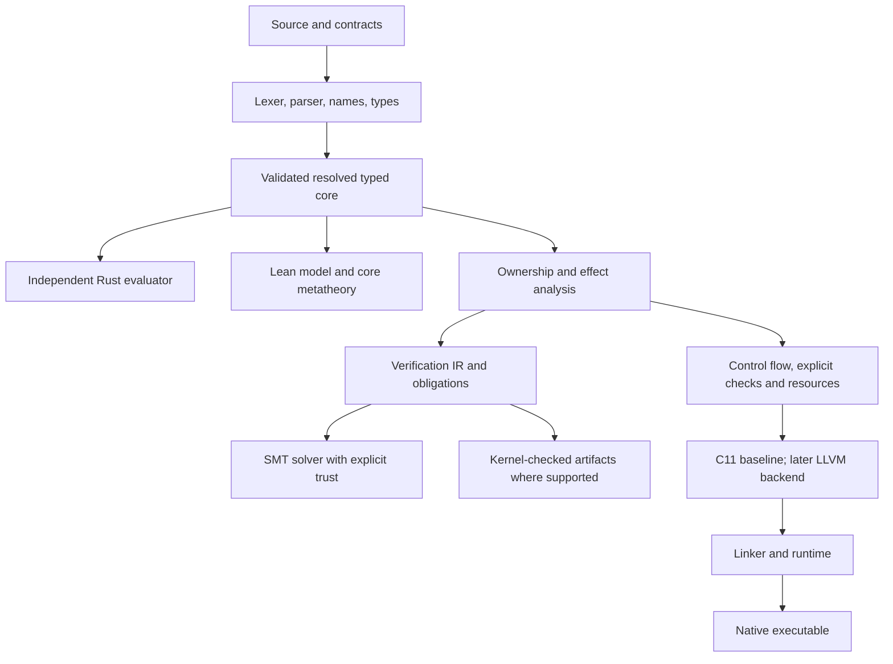

# APL architectural overview

Status: architecture for the complete language, with an implemented M1 scalar
checker/interpreter and a mechanized expression subset. Later compiler, runtime,
verification, and ecosystem sections describe planned capabilities. This bounded
M1 implementation and theorem coverage leave the complete-language release
requirements open.

The [decision records](decisions.md) summarize alternatives and proof obligations.
The [bibliography](../research/bibliography.md) lists the supporting literature.

## Purpose and requirements

APL is intended to combine strong static typing, predictable native execution,
expressive functional and imperative programming, and practical verification.
Systems software must be possible without a mandatory tracing collector.
Agent applications use the same types, memory rules and runtime as other software.

The [language charter](../charter.md) defines the project scope. The
[requirements](../requirements.md) describe the capabilities and evidence required
for release. Language changes must preserve consistent semantics across the
specification, compiler, formal model and runtime.

The design prioritizes correctness, explicit semantics, performance control,
composable abstractions, optional deeper proofs and usable developer workflows.
Typing is mandatory. A proof obligation is never considered discharged because a
program compiled, passed tests, or was described convincingly.

## Language and memory foundation

Use a strict expression-oriented language with explicit function signatures,
bidirectional local checking, nominal data types and rank-1 parametric generics.
Local bindings begin monomorphic. This keeps module boundaries independently
checkable while reducing local annotations. The complete feature inventory
includes closures, exhaustive patterns, structured mutation, explicit errors,
arrays/slices/records/collections and primitive numeric/text types.

Choose affine ownership for resources and shared/exclusive borrows for access.
Owned resources have a single destruction responsibility. Lexical regions are the
first analyzable implementation boundary; more flexible regions require their own
rules and evidence. The first ownership milestone restricts aggregate borrows and
partial moves explicitly. These restrictions do not erase final-language goals.

Pure functions have no external effects but may trap or diverge. Effects describe
possible interactions; opaque capability values authorize particular interactions.
One does not replace the other. Floating-point rules, higher-order effects,
heap aliasing and weak atomics each require a normative extension before exposure.

[Type-system specification](type-system.md) contains the judgments and feature
choices. [Language and memory research](../research/language-and-memory.md)
compares HM and bidirectional inference, ownership/regions/GC, traits, refinements,
dependent types, effects, capabilities, typestate, sessions and higher-kinded types.

## Executable core and semantic contract

M1 is a strongly typed scalar/function core with `i64`, `bool`, unit, immutable
bindings, blocks, conditionals, scalar operators and named recursive functions.
The [grammar](../../spec/grammar.ebnf) defines its exact syntax. The executable
entry is nullary `main` returning `i64`. Library checking does not require an entry.

Integers have mathematical checked semantics in the signed 64-bit range.
Overflow, zero division and minimum-integer divided or remaindered by -1 trap.
Division truncates toward zero. Operands and arguments evaluate left to right;
boolean operators short-circuit and conditionals select one branch. Resource
limits in tooling are distinct from traps and divergence.

The core bounds the first implementation and proof task. It is not the planned
release feature set. Native compilation, contracts, mutable data, memory and
concurrency extend the same semantic framework in later increments.

The current Rust CLI implements `check`, `eval`, `dump-core`, and `eval-core`.
It checks every function, interprets checked source, and independently validates
imported [core JSON](../../spec/core-format.md). [Getting started](../getting-started.md)
provides build/run commands and executable examples. Lean's
[proof inventory](../../formal/PROOFS.md) records expression typing, preservation,
progress, and finite evaluator correspondence. Recursive programs have executable
conformance coverage and mathematical call semantics; FM-05 call safety and
correspondence proofs remain open. No theorem proves the Rust implementation.

## Compiler and formal-methods architecture

The source frontend, typed core, Rust evaluator, and Lean model exist today.
Ownership/effects, verification obligations, MIR, native code generation, and
runtime linking remain planned stages of this pipeline.

Rust implements the production frontend and toolchain. Lean independently models
semantics and checks metatheory. This separation supports independent comparison
but creates a correspondence obligation. No proof automatically crosses the
parser, serializer, type checker, runtime or backend boundary.

The typed core uses resolved identities and explicit types. MIR exposes evaluation
order, branches, traps, and later moves/borrows/drop. Each IR has a validator.
Imported artifacts are untrusted input even if they contain type annotations.
The shared exchange format uses decimal strings for integers and de Bruijn indices
for locals, with a semantic revision that invalidates stale results.

The initial native backend emits checked C11 with explicit temporaries and a
small runtime. It must avoid C signed-overflow UB and unspecified evaluation order.
LLVM is the intended production optimization backend after independent semantic
comparison and workload evaluation. Cranelift remains a credible alternative;
MLIR is deferred until workloads justify multi-level transforms. Backend reputation
does not establish APL performance or compiler correctness.

Program verification first covers pure first-order loop-free functions. Weakest
preconditions produce named safety and contract obligations. SMT automation is
labeled with solver trust; kernel-checked evidence has a distinct trust level.
Arithmetic obligations include intermediate range checks and source division
semantics. Recursion, loops, heap state, concurrency and ghost erasure require
explicit extensions. Assertions are obligations, never implicit assumptions.

[Compiler contracts](compiler.md), [formal architecture](formal-methods.md) and
[trust boundaries](trust.md) define pass interfaces, theorem coverage, verification
statuses and the limits of claims. Soundness of an expression fragment is separate
from soundness of recursive function environments and implementation correspondence.

## Runtime, concurrency and standard library

The runtime is layered by required capabilities. Scalar programs need only entry,
trap and linking support. Allocation, I/O, threads, async execution, tracing and
durable workflows add components when used. The standard library builds safe
interfaces over explicit OS/FFI boundaries and avoids mandatory tracing GC.

Ownership and transfer rules support safe native threads and channels. Shared
mutable state requires synchronization; the initial atomic model is sequentially
consistent. Structured task scopes own children, cancellation and cleanup. Async
suspension preserves resource/borrow constraints. Race freedom does not establish
deadlock freedom, starvation freedom or workflow correctness.

The library plan covers text, collections,
iterators, files/paths/I/O, networking, time/processes, synchronization/async,
errors, formatting/parsing/serialization, tests and logging/tracing. Cryptographic
APIs wrap established implementations through reviewed boundaries. Compatibility
and documentation are public API obligations. See [runtime architecture](runtime.md).

## Agent programming

Agents are typed libraries over ordinary functions, ADTs, channels, capabilities
and structured concurrency. Dedicated syntax is unnecessary until evidence shows
a semantic requirement libraries cannot express. Opaque runtime-enforced
capabilities govern tool authority, while protocol/state contracts constrain
workflow transitions. Model responses remain untrusted data.

Durability separates deterministic transitions from external activities. Replay
consumes recorded observations and compares commands instead of repeating side
effects. Unknown remote outcomes after a crash require idempotency or reconciliation.
Budgets and approval boundaries must be enforced by runtime state, not just types.
[Agent architecture](agents.md) specifies this boundary and adversarial tests.

## Packages, developer tools and distribution

A single CLI and compiler library provide consistent checks, build/run, testing,
verification, formatting, linting and documentation. Packages use declared modules,
versioned manifests, resolved lockfiles and content identities. Compiler, semantic
revision, target and runtime ABI participate in build-cache keys. Build scripts
and package fetching must not create hidden ambient authority.

LSP exposes compiler diagnostics and completion to editors. Native debug metadata
supports actual debugger sessions. Commands are shipped when they perform their
documented work; unimplemented behavior cannot be reported as success.

Initial validation uses the macOS arm64 host and subsequently a Linux x86-64 CI
runner. Other platforms remain requirements for explicit support decisions and
clean installation qualification, not implied portability claims. Final releases
provide versioned artifacts, integrity checks, upgrade/uninstall instructions and
bundled ordinary-user dependencies. Proof development tools remain contributor
dependencies. Public package names must be resolved before registry publication.
See [tooling architecture](tooling.md).

## Education and publication

Documentation grows with executable examples. The final ecosystem includes the
Book, by-example collection, language/stdlib references, verification, compiler,
agent, installation, contributor and migration/interoperability guides. Content
is versioned, navigable and searchable, with examples checked against the compiler.

The whitepaper accumulates actual evidence during development. Its final source
and typeset PDF must include formal judgments and
theorems, architecture, memory/concurrency/agents, reproducible performance,
related work, assumptions and limitations. A claim inventory links statements to
proofs, implementation and measurements. A design overview is not that final paper.

## Validation, dependencies and risk

The [roadmap](../roadmap.md) defines executable milestones and the
dependency graph. Source conformance, independent evaluator comparisons, native
execution, mechanized proofs, fuzzing, sanitizers and security review provide
different evidence. Each must be interpreted within its actual coverage.

The highest risks are semantic drift, incomplete soundness arguments, unsafe
ownership/concurrency interactions, false SMT success, backend UB and excessive
ecosystem scope before foundational behavior works. Mitigations are explicit
contracts, small executable increments, negative/adversarial cases, independent
review and a requirement ledger that keeps every missing release capability open.

Every improvement cycle states a hypothesis and baseline, implements a language
capability, checks affected proofs and regressions, measures relevant outcomes and
integrates only accepted changes. The [current baseline](../../benchmarks/README.md)
measures local release-CLI checking and interpretation with explicit outcome
checks. It is an initial measurement, not a speedup or native-performance claim.
