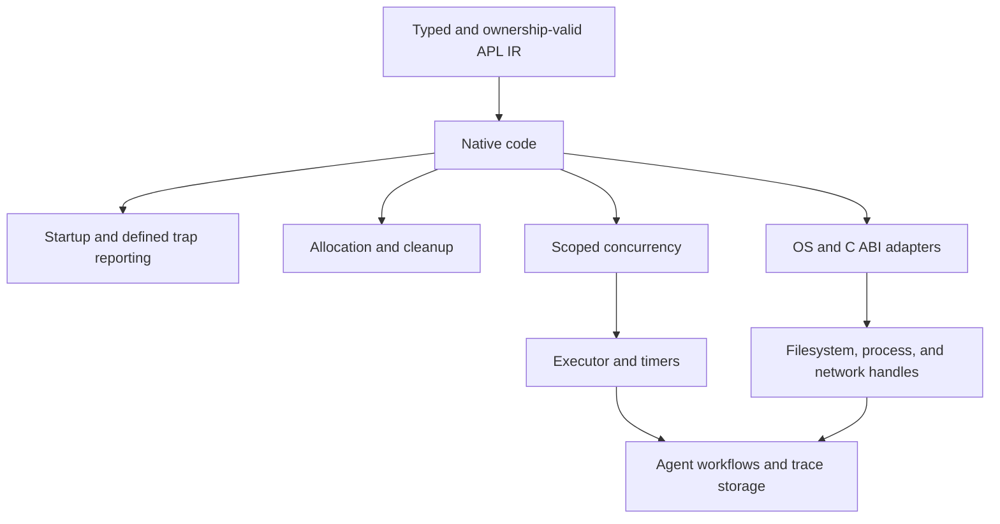

# Runtime and systems architecture

Status: broader runtime facilities below remain design proposals unless linked to
implementation evidence. Current execution supports scalars, flat tuples and local
state as defined by the [type-system specification](type-system.md).

## Runtime components follow language capabilities

An arithmetic-only APL program requires startup, native scalar operations, and a defined failure path. It does not require a garbage collector, allocator, event loop, thread pool, network stack, or model client. Programs link runtime modules when their capabilities require them.

The runtime is part of the trusted computing base until specific components receive machine-checked evidence. Native backend correctness and operating-system behavior remain explicit assumptions even when source-level properties have proofs.

## M1 and first native slice

M1's reference evaluator represents `i64`, `bool`, and `unit` directly and returns a value, a defined arithmetic trap, or interpreter resource exhaustion. It preserves left-to-right evaluation, conditional branching, and boolean short-circuiting. It must never map resource exhaustion to a language value or successful verification.

For the first native executable, a host wrapper invokes `main() -> i64`, prints the full signed decimal result followed by a newline, and exits successfully. A defined arithmetic trap reports failure and exits unsuccessfully. The wrapper never converts the language result to an eight-bit process status. The wrapper's output is a tool convention; it does not give M1 source code an I/O operation.

The C11 backend lowers checked arithmetic without first executing an overflowing C signed operation. Left-to-right evaluation requires explicit temporaries because the backend language's argument evaluation order is not APL's contract. Division and remainder guard zero and `INT64_MIN / -1` before evaluation. Native and reference results must match for both successful and trapping programs.

The flat-tuple extension uses immutable validated values in the reference
evaluator and ordinary struct values in generated C. Whole-value replacement
preserves earlier snapshots. Tuple-bearing interpretation has checked cumulative
allocation-work and logical-slot budgets; these are not heap-byte caps. Native
tuple operations need no generated heap allocation and do not inherit those
interpreter budgets. See the [resource contract](../../spec/flat-products.md#checked-resource-limits).
This does not implement source-level ownership, references or an allocation API.

## Storage and cleanup

The storage model distinguishes stack locals, owned heap allocations, and borrowed views. A heap allocation has an allocation identity, a size, an alignment, initialized byte ranges, and an owner. References retain provenance from that allocation or stack place. Integer arithmetic cannot manufacture a safe reference.

Allocation is explicit in owning library APIs. Fallible allocation returns a typed error when recovery is part of the API. An infallible convenience API may abort on allocation failure, but must document that behavior. The optimizer may remove an allocation only when it preserves observable behavior and failure assumptions covered by its correctness argument.

Normal scope exit and error propagation destroy initialized owned locals in reverse binding order. Moving a value transfers its cleanup obligation. Destroying a record destroys fields in reverse declaration order. Replacement evaluates the replacement first, then destroys the old value, then installs the new value. The first implementation rejects partial initialization and partial moves rather than inventing implicit cleanup behavior.

Destructors must not suspend or unwind across a native boundary. Explicit `close` or `flush` operations return recoverable errors when cleanup can fail. A destructor cannot reliably report those failures through an ordinary return value. Process abort, forced termination, and power loss do not promise cleanup.

Optional arenas, reference counting, and managed heaps are library mechanisms with explicit owners. `Rc` is confined to one thread. `Arc` requires atomic ownership accounting. Cycles may retain memory unless the chosen mechanism breaks them. Memory safety does not imply absence of leaks.

## Memory-safety obligations

The safe language must prevent reads of uninitialized values, use after free, out-of-bounds access, double destruction, invalid alignment, invalid typed values, and conflicting unsynchronized memory accesses. A reference must have a live allocation, an in-bounds range, appropriate alignment, and the permission required by the operation.

Bounds checks remain unless an analysis proves their removal sound. Safe slice APIs preserve length and provenance. A pointer-plus-length crossing an FFI boundary is not automatically a valid slice. The wrapper must validate what it can and state the lifetime, ownership, and initialization assumptions it cannot check dynamically.

These properties are implementation obligations. A scalar-core type-soundness theorem does not establish heap memory safety or data-race freedom for future language versions. The [RustBelt research](https://plv.mpi-sws.org/rustbelt/) motivates proof obligations for unsafe library implementations as well as safe language rules.

## Concurrency and memory ordering

The first supported concurrency model uses native threads with scoped ownership transfer, bounded channels, mutexes, and sequentially consistent atomics. The abstract model interleaves thread steps. Mutex unlock publishes protected writes and a later successful lock acquires them. Sending a message transfers ownership; a successful receive establishes visibility of the message's initialization. Spawn and join establish visibility at the corresponding lifetime boundaries.

`Send` means ownership may cross a thread boundary. `Sync` means shared references may cross it. The compiler derives these properties only when every relevant field satisfies the corresponding rule. Raw pointers, unsynchronized cells, and non-atomic reference counts receive neither property automatically. Trusted implementations require explicit invariants and review.

Scoped threads cannot outlive borrowed parent storage. A scope must join all children before releasing that storage. A detached task requires owned or static captures. Channel closure, cancellation, peer failure, and timeout have typed outcomes. Sending an owned value on a failed operation either returns ownership or consumes it according to the documented API; it cannot leave ownership ambiguous.

Sequential consistency is the initial atomic contract. Weaker orderings require a separate axiomatic memory model, backend correspondence, litmus tests, and verification rules before release. The runtime cannot silently lower a sequentially consistent operation to a relaxed one.

The intended safety claim is freedom from data races in safe programs under valid runtime and FFI assumptions. Deadlock freedom, starvation freedom, fairness, and deterministic scheduling are separate properties. No initial scheduler policy establishes them automatically.

## Async and cancellation

An async function lowers to an owned state machine. Suspension saves initialized locals and their cleanup obligations. A future cannot move while native pointers into its storage are live unless the representation provides a proved stable address. A future that captures thread-confined state cannot migrate between worker threads.

Structured task scopes own their children. Cancellation is cooperative and occurs at documented suspension or polling points. Canceling a task runs cleanup for the live state when the executor can regain control. A foreign blocking call may delay cancellation. The runtime does not use asynchronous thread termination to simulate safe cancellation.

Timeout is a local observation that a deadline expired. It is not proof that an external request did not execute. Retrying an external operation therefore requires idempotency keys or a protocol that tolerates duplicates. Agent workflow libraries inherit these rules.

## Native interfaces and layout

Native ABI adapters use fixed-width integers and explicit status or result representations. A future `repr(C)` declaration commits to target-specific size, alignment, field order, and calling convention. Ordinary APL records have no stable external layout promise. Packed memory is accessed through byte operations unless alignment is independently established.

C calls are unsafe by default. A safe wrapper must account for pointer validity, length, encoding, ownership transfer, callback lifetime, concurrency, and error behavior. Foreign exceptions or `longjmp` must not cross APL frames unless an accepted unwind protocol explicitly supports them. Callbacks enter through generated ABI thunks that validate the permitted context.

The compiler owns the layout description. Runtime code consumes a generated, versioned layout and calling-convention interface. Hand-maintained duplicate assumptions about enum tags, closure captures, or slice layout are prohibited. Debug information must describe the same layouts used by native code.

## Standard-library layers

| Layer | Contents | Dependencies and invariants |
| --- | --- | --- |
| `core` | Scalars, tuples, option and result, iterator interfaces, comparison, formatting contracts | No allocator or OS requirement; generics and ADTs prerequisite |
| `alloc` | Owned UTF-8 text, vectors, maps, boxes, arenas | Allocator capability, ownership, overflow-safe size arithmetic |
| `std` | Files, paths, I/O, network sockets, clocks, processes, serialization, logging | Typed OS handles and errors; validate bytes before constructing text or records |
| `sync` | Scoped threads, channels, mutexes, atomics | Accepted concurrency model, `Send` and `Sync`, runtime invariant tests |
| `async` | Futures, executor, timers, cancellation | Stable future storage and drop-state analysis |
| `agent` | Typed tools, durable workflow state, event traces, replay, budgets | Capabilities, serialization, clock and storage adapters, deterministic test drivers |
| `crypto` | Safe adapters to established cryptographic implementations | No novel cryptographic algorithms; explicit dependency and secret-handling review |

Ordinary I/O failure uses typed errors. A panic is reserved for violated assertions or unrecoverable conditions and has an explicit runtime outcome. Logging and tracing do not include capability secrets or arbitrary model payloads by default. Standard-library examples are executable tests when their facilities exist.

## Interfaces and acceptance gates

The compiler supplies ownership-valid operations, layout descriptors, and source locations. The runtime supplies allocator and OS adapters with documented preconditions and postconditions. The verifier models each external operation through a named contract, which remains an assumption until implementation evidence discharges it.

Before heap support, require use-after-move and aliasing rejection tests, cleanup tests across ordinary and error exits, allocator-failure tests, and a reviewed store semantics. Before concurrency, require scoped-lifetime tests, negative `Send` and `Sync` cases, channel closure tests, cancellation cleanup tests, synchronization litmus tests, and an independent safety review. Before FFI, require positive and negative ABI integration fixtures on every advertised target.

Performance work must measure allocation counts, contention, task scheduling, executable size, and latency using reproducible workloads. This architecture predicts no numerical performance advantage. The initial open risks are ownership-checker correspondence, cancellation state cleanup, runtime synchronization correctness, target ABI differences, and the trusted scope of foreign libraries.
