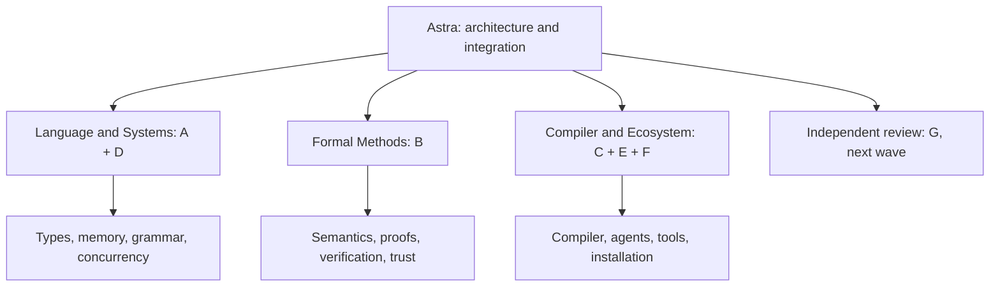

# Organization and ownership

## Leadership

Astra, the root coordinator, owns architecture acceptance, requirements,
integration, evidence review, and release qualification. Engineering work is
delegated through bounded assignments with explicit interfaces and tests.

The host permits four concurrent agents including the coordinator. The seven
Phase 0 teams therefore run in grouped assignments and successive waves.
These are real execution limits, not a proposed limit on the eventual organization.
No persistent background service has been established.

## Phase 0 assignments

| Team | Current agent | Deliverables and owned paths | Acceptance evidence |
| --- | --- | --- | --- |
| A Language and types | `language_architecture` | `docs/research/language-and-memory.md`, `docs/architecture/type-system.md`, `spec/grammar.ebnf` | Compare type features from charter §3; define M1 syntax and judgments; state deferred features and proof obligations |
| D Runtime and systems | `language_architecture` | `docs/architecture/runtime.md` | Memory and concurrency rules, ownership boundary, unsafe/FFI trust, runtime dependency stages |
| B Formal methods | `formal_architecture` | `docs/research/formal-methods.md`, `docs/architecture/formal-methods.md`, `docs/architecture/trust.md` | Compare mechanization and verifier designs; select compatible semantics; define proof coverage and verification statuses |
| C Compiler | `compiler_ecosystem_architecture` | `docs/research/compiler-and-ecosystem.md`, `docs/architecture/compiler.md` | Backend comparisons, IR invariants, testable M1/M2 implementation contracts |
| E Agent programming | `compiler_ecosystem_architecture` | `docs/architecture/agents.md` | Capability enforcement, protocol/replay boundaries, explicit external assumptions |
| F Developer ecosystem | `compiler_ecosystem_architecture` | `docs/architecture/tooling.md` | CLI/package/editor/install architecture, reproducibility and user acceptance plan |
| G Independent review | Awaiting research completion and a free slot | `docs/research/independent-review.md` | Challenge cross-team consistency; record findings and dispositions before acceptance |
| Integration and publications | Root coordinator | Overview, requirements, roadmap, decision records, bibliography, contribution strategy, `notes.md` | Review source artifacts; resolve conflicts; maintain traceable acceptance evidence |

All research assignments must compare alternatives, cite primary sources, explain
formal and performance consequences, identify dependencies and open questions,
and produce substantive files. Architecture research does not authorize speculative
implementation before the Phase 0 gate.

## Engineering ownership after architecture acceptance

| Division | Accountable role | Responsibilities | Integration contract |
| --- | --- | --- | --- |
| Language | Language lead | Syntax, types, ownership, effects, evolution | Normative specification and negative conformance cases |
| Formal methods | Formal lead | Core metatheory, verifier, proof regression | Versioned semantics, proof coverage and trust ledger |
| Compiler | Compiler lead | Frontend, IRs, optimization, native output | Validated typed IR and differential behavior |
| Runtime and library | Systems lead | Memory, I/O, FFI, threads, async, standard library | Runtime ABI, resource and error semantics |
| Agent systems | Agent lead | Tools, workflows, capabilities, replay | Typed messages, authority and durable effect boundaries |
| Developer experience | Tooling lead | Packages, CLI, LSP, docs, installation | One versioned toolchain, reproducible dependency graph |
| Quality and release | Independent reviewer | Security, fuzzing, benchmarks, release qualification | Evidence at the exact integrated revision |
| Research and publications | Publications lead | Bibliography, claim tracking, book, whitepaper | Every published guarantee points to proof or test evidence |

Roles are assigned to actual agents as tasks become executable. Unstaffed roles
are ownership requirements, not claims that additional agents exist. Add managers
when independent parallel components justify them.

## Change and review procedure

The coordinator provides each worker its mission, requirements, owned paths,
interfaces, dependencies, proof obligations, commands and expected outcomes.
Workers report concrete artifacts and checks. Critical work receives review from
an agent other than its author, then integration checks against the current tree.
A changed contract requires its dependent teams to acknowledge the change.
