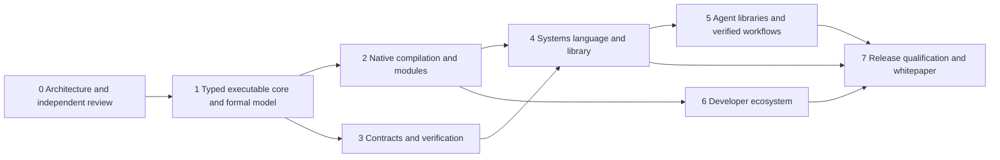

# Delivery roadmap

## Dependency order

Proof coverage, tests, documentation and native/reference comparisons grow with
each implemented feature. M3 can progress alongside native compiler work once M1
contracts are stable. A phase number expresses dependencies, not a claim that all
work in prior phases is finished.

## M0: accepted architecture

Deliver every item P0-01 through P0-18 in the requirement ledger. Review the
integrated design independently. Resolve blocking contradictions in types,
memory, evaluation, compiler IRs and verification. Record unresolved research
questions with bounded first milestones. Push the reviewed artifacts to GitHub
and record architectural acceptance. Then start M1 without a further permission
checkpoint.

## M1: typed executable core

Implement the agreed scalar/function language as one working source-to-execution
path. It includes a lexer, parser, source spans, AST, name resolution, static
typing, immutable local inference and deterministic interpretation. The current
proposal contains `bool`, `i64`, unit, `let`, conditionals, operators and named
functions including recursion. The ratified grammar and contracts are normative.

Acceptance requires actual source programs, rejection of ill-typed and malformed
programs, arithmetic boundary/trap tests, recursion and scope tests, and build/test
instructions. Mechanize the explicitly named formal subset and run the proof
checker. Execute independent model comparisons where the formal model overlaps
the source language. Record call coverage separately from expression proofs.
Do not label fuel exhaustion as a language trap or as evidence of divergence.

Assign frontend/type checking, interpreter/conformance, and formal foundations to
separate owners after agreeing their shared types. Independently review these
contracts and implementations before closing M1.

## M2: native compiler

Add validated typed and lowered IRs, native backend/linker integration, basic
runtime, module boundaries, and source diagnostics. Check arithmetic and sequence
all operations according to the core semantics. Verify generated native binaries
on macOS arm64 initially and Linux x86-64 through CI before claiming support there.
Compare native results and traps against the independent model and interpreter.
Include multi-module command-line programs. Keep backend correctness assumptions
explicit; use of a mature backend is not a compiler proof.

## M3: program verification

Add contracts, assertions, VC generation, solver/proof integration, and diagnostics.
Acceptance includes true and false properties, counterexamples where supported,
unknown/timeouts, missing/crashed tools, arithmetic faults, unsatisfied call
preconditions, inconsistent specifications, and proof-regression CI. Expand to
loop invariants, ghost code and state specifications when their language features
exist. Bind verification artifacts to the exact program, semantics and tool
versions. Report the implemented trust level for each result.

## M4: practical systems language

Implement the remainder of the type system, ownership/borrowing, data types,
generics, closures, pattern matching, errors, effects, concurrency/async, I/O,
layout and FFI. Deliver a substantive standard library including the full §18
inventory. Every extension needs normative semantics, conformance and misuse
tests, appropriate formal coverage, integration examples and documentation.

Acceptance includes a generic collection, parser, file-processing utility, native
library integration, concurrent application and network service. Evaluate the
listed optimizations against reproducible workloads. Runtime and unsafe code need
independent security review. No data-race claim extends to deadlock freedom.

## M5: agent systems

Build typed tools, capabilities, structured workflows, durable state, budgets,
observability, cancellation/retry and deterministic replay. Verify protected-state
and protocol properties under named external assumptions. Acceptance includes
multi-agent communication, missing-capability rejection, crash recovery,
duplicate-effect behavior, replay checks and adversarial authorization tests.
Model outputs remain untrusted input even when a workflow is verified.

## M6: developer ecosystem

Complete packages and locked builds, project scaffolding, formatting, linting,
tests, documentation generation, LSP/editor integration and debugging. Provide
versioned docs and examples. Measure compile/runtime/size/memory/verification
costs against appropriate reference implementations, with raw data and commands.
Acceptance requires user workflows, dependency conflict/integrity tests,
formatting idempotence, real editor interactions, debugging and clean builds.

## M7: qualified release

Audit all charter requirements against the actual revision. Close release
blockers. Build versioned installation artifacts with checksums and appropriate
integrity mechanisms. Validate install/upgrade/uninstall in clean supported
environments. Ordinary users must not require internal development dependencies.

Publish the complete learning ecosystem and substantive whitepaper as source and
a visually checked typeset PDF. Every technical claim refers to implementation,
proof or measurement evidence. Fresh-context agents receive only published
materials and perform every §32.5 developer journey. Correct their findings,
revalidate the release artifacts, and record the final requirement audit.

## Risks and decision triggers

| Risk | Consequence | Response and trigger |
| --- | --- | --- |
| Implemented and formal semantics diverge | Unsound claims and misleading verification | Share versioned interchange contracts; independently execute boundary cases; expand proof coverage explicitly |
| Ownership, generics and concurrency interact unsafely | Memory corruption or races in safe code | Stage features behind precise rules; negative tests and adversarial formal review before exposure |
| SMT encoding omits traps or inconsistent assumptions | False verification success | Track well-definedness obligations; adversarial false properties; distinguish solver trust from kernel proof |
| Backend uses C undefined behavior or reorders effects | Native output violates source semantics | Checked arithmetic helpers, explicit sequencing, differential tests and sanitizers |
| Ecosystem work exceeds language maturity | Tooling advertises unsupported behavior | Add commands only with working implementations; preserve full pending requirements |
| Model proofs are mistaken for implementation proofs | Unsupported safety claims | Maintain theorem-by-theorem coverage and TCB; independent release claim audit |
| Package/name/platform decisions remain unresolved | Distribution and onboarding blocked | Resolve before public package/release publication; retain selected ANL repo meanwhile |
| Host capacity or session interruption | Lost execution context | Versioned assignments and exact handoffs; verify process/agent state before resuming |
