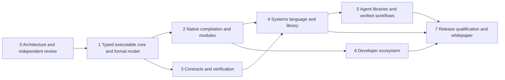

# Delivery roadmap

## Dependency order

Proof coverage, tests, documentation and native/reference comparisons grow with
each implemented feature. M3 can progress alongside native compiler work once M1
contracts are stable. A phase number expresses dependencies, not a claim that all
work in prior phases is finished.

Current status: the scalar checker/interpreter, native C11 backend, file modules,
initialized mutable locals, while loops, versioned core JSON interchange, loop-free
scalar contract verification with acyclic calls, and scoped Lean proofs are
available. Follow [getting started](getting-started.md) to run the tools and the
[proof instructions](../formal/README.md) to check the formal artifacts. Finite
evaluator correspondence is proved in both directions for the scalar function
v0 model, with sufficient depth and fuel. Local state has a separate typed machine
and finite transition/run correspondence. The [52 technical release requirements](requirements.md)
remain open in their full scope, including later language, verification, and
ecosystem capabilities.

## M0: architecture

Define compatible syntax, type rules, memory semantics, compiler representations
and verification boundaries. Compare competing designs and document technical
risks. Independent review must resolve contradictions that would prevent an
executable implementation. The architecture is a design artifact, not proof that
its capabilities exist.

## M1: typed executable core

Implement the agreed scalar/function language as one working source-to-execution
path. It includes a lexer, parser, source spans, AST, name resolution, static
typing, immutable local inference and deterministic interpretation. The current
implementation contains `bool`, `i64`, unit, `let`, conditionals, operators and named
functions including recursion. The ratified grammar and contracts are normative.

Acceptance requires actual source programs, rejection of ill-typed and malformed
programs, arithmetic boundary/trap tests, recursion and scope tests, and build/test
instructions. Mechanize the explicitly named formal subset and run the proof
checker. Execute independent model comparisons where the formal model overlaps
the source language. Record call coverage separately from expression proofs.
Do not label fuel exhaustion as a language trap or as evidence of divergence.

Keep the frontend, evaluator and formal model aligned through explicit shared
contracts. Independently review these contracts and implementations before
closing M1.

The Rust CLI currently checks, evaluates, exports, and imports that core.
Source and boundary conformance tests cover valid programs, static rejection,
arithmetic traps, recursion, scoping, and resource/I/O failures. Lean's
[theorem inventory](../formal/PROOFS.md) discharges FM-01 through FM-05 for the
documented scalar expression/function model, including finite correspondence
with the actual bounded evaluator in both directions. Program completeness
quantifies sufficient depth and fuel; it proves neither termination nor
completeness at the CLI's fixed depth of 256. Rust/model correspondence remains
testing evidence under FM-06. Source, module, and backend correctness require
separate evidence.

## M2: native compiler

Add validated typed and lowered IRs, native backend/linker integration, basic
runtime, module boundaries, and source diagnostics. Check arithmetic and sequence
all operations according to the core semantics. Verify generated native binaries
on macOS arm64 initially and Linux x86-64 through CI before claiming support there.
Compare native results and traps against the independent model and interpreter.
Include multi-module command-line programs. Keep backend correctness assumptions
explicit; use of a mature backend is not a compiler proof.

The current [native compiler](native-compilation.md) validates structured MIR,
emits checked C11, and builds host executables. Native and module checks passed
[macOS AArch64 and Linux x86-64 CI](https://github.com/djsydney04/ANL/actions/runs/44043755444)
at `19d726c`. [File modules](modules.md) add private
interfaces, qualified paths, bounded import graphs, and source diagnostics;
the whole graph currently lowers to one translation unit. Separate-object
compilation, source debugging, broader runtime features, and release qualification
remain pending. Module resolution and backend correctness are tested boundaries.

## M3: program verification

The current [verifier](verification.md) supports typed mathematical-integer
`requires`/`ensures` clauses, guarded arithmetic-safety conditions, and acyclic
call expansion across the complete loaded graph, including loop-free mutable
scalar locals and assignment. It checks ordered precondition
definedness and satisfiability, calls the pinned Z3 5.3.3, and emits exact source,
tool, and query bindings. Results are `smt-trusted`; refuting models are unreplayed.
Ordinary compilation erases contracts without dynamic checks.

The [formal inventory](../formal/PROOFS.md) proves soundness of call-free generation
and finite symbolic body expansion, including left-to-right arguments and ordered
callee-precondition insertion, when generation succeeds. A separate state-aware
generator proves loop-free mutation and typed contracts over the local-state
machine. FM-07 remains partial:
source call-graph checking, sufficient expansion bounds for acyclic programs,
equivalence with a separate syntax-inlining pass, named-condition decomposition,
and Rust/SMT/solver bridges remain open, including correspondence between the
state model and production forward analysis. The production verifier rejects
loops and recursion before tool discovery. Source `invariant` clauses are accepted
and type-checked at the loop head, then erased; their truth and definedness are
not established. Assertions, recursive and
loop-invariant verification, ghost code, and heap properties remain future work.

Complete M3 acceptance includes true and false properties, counterexamples where
supported,
unknown/timeouts, missing/crashed tools, arithmetic faults, unsatisfied call
preconditions, inconsistent specifications, and proof-regression CI. Expand to
invariant verification, ghost code and state specifications with their required
semantics and proof coverage. Bind verification artifacts to the exact program,
semantics and tool versions. Report the implemented trust level for each result.

## M4: practical systems language

The first local-state slice implements initialized scalar `let mut`, assignment,
and structured while statements through the interpreter, strict v1 interchange,
validated MIR slots, and native C11 loops. The separate Lean model proves typing,
progress/preservation, finite machine correspondence, and forward preservation of
finite v0 evaluator outcomes. It does not establish termination, reverse divergence
correspondence or Rust/JSON/native correctness. Loop-free state verification has
the separate model and implementation boundaries described in M3. Local
runtime/proof checks and [hosted Linux/macOS Rust and Lean checks](https://github.com/djsydney04/ANL/actions/runs/44059286145)
passed at `f8ffb5f128aab5eaed4db3770ae500cd923cc61c`.

Implement the remainder of the type system, ownership/borrowing, data types,
generics, closures, pattern matching, errors, effects, concurrency/async, I/O,
layout and FFI. Deliver a substantive standard library covering the
[library requirements](requirements.md). Every extension needs normative semantics,
conformance and misuse tests, appropriate formal coverage, integration examples
and documentation.

Acceptance includes a generic collection, parser, file-processing utility, native
library integration, concurrent application and network service. Evaluate the
listed optimizations against reproducible workloads. Runtime and unsafe code need
independent security review. No data-race claim extends to deadlock freedom.

## M5: agent systems

Build typed tools, capabilities, structured workflows, durable state, budgets,
observability, cancellation/retry and deterministic replay. Verify protected-state
and protocol properties under named external assumptions. Acceptance includes
multi-agent communication, missing-capability rejection, crash recovery,
duplicate-effect behavior, replay checks and adversarial authorization tests.
Model outputs remain untrusted input even when a workflow is verified.

## M6: developer ecosystem

Complete packages and locked builds, project scaffolding, formatting, linting,
tests, documentation generation, LSP/editor integration and debugging. Provide
versioned docs and examples. Measure compile/runtime/size/memory/verification
costs against appropriate reference implementations, with raw data and commands.
Acceptance requires user workflows, dependency conflict/integrity tests,
formatting idempotence, real editor interactions, debugging and clean builds.

## M7: qualified release

Audit all [language requirements](requirements.md) against the actual revision.
Close release blockers. Build versioned installation artifacts with checksums and appropriate
integrity mechanisms. Validate install/upgrade/uninstall in clean supported
environments. Ordinary users must not require internal development dependencies.

Publish the complete learning ecosystem and substantive whitepaper as source and
a visually checked typeset PDF. Every technical claim refers to implementation,
proof or measurement evidence. Independent developer evaluations use only
published materials to install the release, follow a tutorial, build generic,
concurrent, network and agent applications, verify properties, use dependencies,
and interpret diagnostics. Correct their findings, revalidate the release
artifacts, and record the final requirement audit.

## Risks and decision triggers

| Risk | Consequence | Response and trigger |
| --- | --- | --- |
| Implemented and formal semantics diverge | Unsound claims and misleading verification | Share versioned interchange contracts; independently execute boundary cases; expand proof coverage explicitly |
| Ownership, generics and concurrency interact unsafely | Memory corruption or races in safe code | Stage features behind precise rules; negative tests and adversarial formal review before exposure |
| SMT encoding omits traps or inconsistent assumptions | False verification success | Track well-definedness obligations; adversarial false properties; distinguish solver trust from kernel proof |
| Backend uses C undefined behavior or reorders effects | Native output violates source semantics | Checked arithmetic helpers, explicit sequencing, differential tests and sanitizers |
| Ecosystem work exceeds language maturity | Tooling advertises unsupported behavior | Add commands only with working implementations; preserve full pending requirements |
| Model proofs are mistaken for implementation proofs | Unsupported safety claims | Maintain theorem-by-theorem coverage and TCB; independent release claim audit |
| Package/name/platform decisions remain unresolved | Distribution and onboarding blocked | Resolve before public package/release publication; retain selected ANL repo meanwhile |
